# 🚀 Awesome High-Volume Bulk Data API

<p align="center">
  
</p>

<p align="center">
  <a href="https://github.com/ishandutta2007/Awesome-Awesome-Awesome"></a>
  <a href="https://discord.gg/jc4xtF58Ve"></a>
  <a href="LICENSE"></a>
  <a href="https://github.com/ishandutta2007/Awesome-High-Volume-Bulk-Data-API/stargazers"></a>
  <a href="https://github.com/ishandutta2007/Awesome-High-Volume-Bulk-Data-API/network/members"></a>
  <a href="https://github.com/ishandutta2007/Awesome-High-Volume-Bulk-Data-API/issues"></a>
  <a href="#-how-to-contribute"></a>
  <a href="https://github.com/ishandutta2007"></a>
</p>

---

## 📖 Overview & SEO Summary

A curated directory and enterprise architecture guide of **High-Volume Bulk Data APIs**, **batch ingestion systems**, **bulk file processing**, and **high-throughput data replication engines**. 

Whether you are designing petabyte-scale lakehouse ingestion, orchestrating change data capture (CDC) to Apache Iceberg or Snowflake, or bypassing expensive per-row cloud billing with open-source ETL pipelines, this repository catalogs both industry-standard **SaaS enterprise solutions** and production-tested **open-source frameworks**.

### 🔍 Key Capabilities Evaluated
- ⚡ **Batch & Micro-Batch Ingestion**: High-throughput file uploads (Parquet, ORC, Avro, CSV, JSON).
- 🔄 **High-Velocity Replication**: CDC pipelines replicating PostgreSQL, MySQL, Kafka, and MongoDB at hundreds of thousands of records per second.
- 🛡️ **Guaranteed Delivery**: Exactly-once processing, deduplication, backpressure management, and ACID transaction safety.
- 💰 **Predictable TCO**: Comparison of hyperscale managed SaaS costs versus self-hosted, sovereign open-source pipelines.

---

## 📑 Table of Contents

- [🌐 Sector Overview & Market Dynamics](#-sector-overview--market-dynamics)
- [🏢 SaaS & Hosted Platforms](#-saas--hosted-platforms)
- [💻 Open-Source GitHub Projects](#-open-source-github-projects)
- [🏗️ Architectural Ingestion Patterns](#-architectural-ingestion-patterns)
- [🤝 How to Contribute](#-how-to-contribute)
- [📈 Star History](#-star-history)
- [💖 Support & Community](#-support--community)
- [⚖️ Disclaimer & License](#️-disclaimer--license)

---

## 🌐 Sector Overview & Market Dynamics

The global enterprise data integration, bulk data pipeline, and high-volume ingestion market was valued at **$13.48 Billion in 2024** and is projected to expand to **$30.12 Billion by 2030**, advancing at a robust Compound Annual Growth Rate (CAGR) of **~14.2%**. This surge is propelled by enterprise migrations to cloud data lakehouses, astronomical growth in telemetry and observability datasets, and high-frequency vector and raw data pipelines fueling AI/RAG architectures.

The market structure exhibits a **moderately concentrated barbell dynamic** rather than an absolute "winner-take-all" outcome:
1. **The Infrastructure Core (Concentrated)**: Hyperscale cloud ecosystems (Microsoft Azure, Google Cloud, AWS, Snowflake, Databricks) command the primary landing zones and warehouse compute primitives, maintaining immense pricing power over data storage and query scanning.
2. **The Ingestion & In-Motion Tier (Moderately Fragmented)**: Specialized vendors (Fivetran, Segment, Mixpanel) and high-performance open-source streaming/batch engines (ClickHouse, Airbyte, Vector, Apache Iceberg, Debezium, OLake) capture high-growth niches. Organizations increasingly deploy a hybrid strategy—leveraging open-source replication engines to avoid multi-million-dollar per-row vendor billing while bulk-loading directly into hyperscale analytical warehouses.

---

## 🏢 SaaS & Hosted Platforms

The following enterprise platforms provide managed, high-availability APIs and services for bulk data loading, batch extraction, and large-scale data synchronization. 

*The table is sorted by **Company Valuation / Market Cap / Revenue (Descending)** to reflect organizational scale and enterprise footprint.*

| 🏷️ Platform / Service | 🏢 Parent & Valuation / Revenue | 📝 Description & Bulk API Capabilities | 💵 Pricing (Starting Tier Price) | 🎁 Free Tier & Free Trial Limits |
| :--- | :--- | :--- | :--- | :--- |
| **[Azure Data Factory Bulk Copy](https://azure.microsoft.com/en-us/products/data-factory)** | **Microsoft Corp.**<br>• Market Cap: **~$3.12 Trillion**<br>• Cloud Revenue: **~$130B+/yr** | Enterprise hybrid cloud ETL/ELT service featuring bulk copy activities with 90+ native data connectors, auto-partitioning, and managed Integration Runtimes. | **$1.00 per 1,000 activity runs** (Data Pipelines); **$0.25/hour per DIU** (Azure Integration Runtime); **$0.10/hour** (Self-Hosted IR). | **Azure Free Account: 30-day trial with $200 credits**; plus **5 low-frequency pipeline activity runs/month permanently free** and 12 months access to core Azure storage services. |
| **[Google BigQuery Bulk Loading](https://cloud.google.com/bigquery/docs/batch-loading-data)** | **Alphabet Inc.**<br>• Market Cap: **~$2.15 Trillion**<br>• Google Cloud: **~$40B+/yr** | Serverless analytical warehouse offering high-speed batch data ingestion from Cloud Storage supporting Parquet, ORC, Avro, CSV, and newline-delimited JSON. | **$6.25 per TB** for on-demand analytical queries; GCS batch bulk loading compute into BigQuery tables is **$0.00 (Free shared pool)**; Active storage is **$0.02 per GB/month**. | **Permanently Free Tier: 10 GB storage and 1 TB query processing per month free forever**; plus Google Cloud **90-day trial with $300 in free credits**. |
| **[AWS Athena & S3 Batch](https://docs.aws.amazon.com/athena/)** | **Amazon.com Inc.**<br>• Market Cap: **~$1.92 Trillion**<br>• AWS Revenue: **~$105B+/yr** | Serverless interactive query and batch ingestion architecture utilizing Amazon S3 Batch Operations to execute high-throughput transforms and object loading. | **$5.00 per TB scanned** by Athena queries; Amazon S3 Batch Operations cost **$0.25 per job + $1.00 per million objects processed**. | **AWS 12-Month Free Tier**: 5 GB Amazon S3 Standard storage, 20,000 GET requests, and 2,000 PUT requests/month; new accounts qualify for AWS promotional credits ($100–$300). |
| **[Salesforce Bulk API v2](https://developer.salesforce.com/docs/atlas.en-us.api_asynch.meta/api_asynch/)** | **Salesforce, Inc.**<br>• Market Cap: **~$280 Billion**<br>• Annual Revenue: **~$35B+/yr** | Asynchronous REST endpoint optimized for ingesting, upserting, or deleting massive CRM datasets (millions of records) in batches without triggering rate caps. | **$165 per user/month** (Enterprise Edition, billed annually), which includes Bulk API v2 access with up to 15,000 batch jobs per rolling 24-hour window. | **30-Day Enterprise Free Trial** with full Bulk API limits; or **Salesforce Developer Edition Org permanently free** (includes 5 MB data storage, 20 MB file storage, and full Bulk API access). |
| **[Snowflake Snowpipe](https://docs.snowflake.com/en/user-guide/data-load-snowpipe-intro)** | **Snowflake Inc.**<br>• Market Cap: **~$55 Billion**<br>• Annual Revenue: **~$3.6B+/yr** | Serverless continuous and micro-batch data ingestion service with auto-detection of cloud storage staging files and serverless elastic compute scaling. | **$2.00 per Credit** (Standard Edition); Snowpipe ingestion rate is **$0.0037 per GB** (effective Dec 2025 pricing model) plus serverless execution warehouse credits. | **30-Day Free Trial with $400 worth of free usage credits**, providing unrestricted access to Snowpipe, virtual warehouses, and cloud storage staging integrations. |
| **[Databricks Auto Loader](https://docs.databricks.com/aws/en/ingestion/cloud-object-storage/auto-loader/production)** | **Databricks, Inc.**<br>• Valuation: **~$43 Billion** (Private)<br>• ARR: **~$2.5B+/yr** | Incremental data ingestion engine for Delta Lake and cloud object stores with File Events notification architecture capable of ingesting >2,000 files/sec. | **$0.07 per DBU** (Databricks Unit) for Jobs Compute on standard tier, plus underlying cloud compute VM infrastructure expenses. | **14-Day Full-Featured Free Trial** across AWS, GCP, or Azure; or **Databricks Community Edition free forever** with a 15 GB single-node cluster. |
| **[Segment Batch API](https://segment-docs.netlify.app/docs/connections/sources/catalog/libraries/server/object-bulk-api/)** | **Twilio Inc.**<br>• Market Cap: **~$11.5 Billion**<br>• Annual Revenue: **~$4.2B+/yr** | Customer Data Platform (CDP) batch ingestion endpoint accommodating uncompressed file payloads up to 512 MB and 400 KB per JSON object with guaranteed sequencing. | **$120 per month** (Team tier, billed monthly or annually, covering up to 10,000 Monthly Tracked Users and 10 custom destinations). | **Free Forever Plan**: Up to **1,000 Monthly Tracked Users (MTUs)**, 2 source connections, and unlimited destinations with unrestricted API access. |
| **[Fivetran Bulk API](https://fivetran.com/docs/developer-resources/rest-api/tutorials/scaling)** | **Fivetran, Inc.**<br>• Valuation: **~$5.6 Billion**<br>• ARR: **~$250M+/yr** | Enterprise automated data integration service featuring programmatic REST endpoints for bulk schema synchronization, connector triggering, and 500+ sources. | **~$500 per month** base starting tier (or pay-as-you-go based on Monthly Active Rows at **~$1.50 per 1,000 MAR** at scale). | **Free Forever Plan**: Up to **500,000 Monthly Active Rows (MAR) per month** across standard connectors, plus a **14-day unlimited volume free trial**. |
| **[Heap Bulk Ingest](https://developers.heap.io/reference/bulk-add-account-properties)** | **Contentsquare / Heap**<br>• Valuation: **~$5.6 Billion** (Parent)<br>• Annual Revenue: **~$300M+/yr** | Digital insights analytics platform providing Bulk Account & User Property APIs to synchronize historical attributes up to 1,000 records per HTTP request. | **$300 per month** (~$3,600/year billed annually) for Growth Tier starter access with automated retroactive data tracking. | **Free Forever Plan**: Up to **10,000 monthly sessions**, unlimited user accounts, core analysis templates, and 6 months of historical data retention. |
| **[Mixpanel Ingestion API](https://docs.mixpanel.com/reference/overview)** | **Mixpanel, Inc.**<br>• Valuation: **~$1.05 Billion**<br>• ARR: **~$100M+/yr** | Event streaming and bulk import API supporting gzip-compressed payloads up to 2,000 events/request with sub-second ingestion and strict schema validation. | **$28 per month** ($20/month billed annually) for Growth Plan covering up to 10,000 Monthly Tracked Users (MTUs) and custom event properties. | **Free Forever Plan**: Up to **20,000,000 events per month** (or 100,000 MTUs) with core product analytics reports and unlimited data integrations. |

---

## 💻 Open-Source GitHub Projects

Open-source frameworks allow data engineering teams to construct custom, cost-effective, self-hosted ingestion engines, eliminate per-row SaaS taxes, and retain total data sovereignty.

*The table below is sorted by **GitHub_Stars (Descending)** and features official stargazers social badges.*

| 📦 Repository & Link | ⭐ GitHub_Stars | 🛠️ Architecture & Focus | 💡 Key Bulk Ingestion Highlights |
| :--- | :--- | :--- | :--- |
| **[ClickHouse](https://github.com/ClickHouse/ClickHouse)** | [](https://github.com/ClickHouse/ClickHouse/stargazers) | Columnar DBMS & Ingestion Engine | World-class bulk insert performance reaching millions of rows per second via native HTTP, TCP, and Arrow endpoints. |
| **[Apache Airflow](https://github.com/apache/airflow)** | [](https://github.com/apache/airflow/stargazers) | Workflow Orchestration Platform | Enterprise-grade DAG-based batch ingestion scheduler with 1,000+ ecosystem providers for coordinating heavy ETL workloads. |
| **[Apache Spark](https://github.com/apache/spark)** | [](https://github.com/apache/spark/stargazers) | Unified Distributed Analytics Engine | Multi-terabyte distributed batch processing engine featuring resilient distributed datasets (RDDs) and vectorized Parquet writers. |
| **[DuckDB](https://github.com/duckdb/duckdb)** | [](https://github.com/duckdb/duckdb/stargazers) | In-Process Analytical SQL Engine | Extremely fast vectorized batch processing capable of scanning and loading multi-gigabyte Parquet and CSV files in seconds. |
| **[Apache Kafka](https://github.com/apache/kafka)** | [](https://github.com/apache/kafka/stargazers) | Distributed Event Streaming Platform | High-throughput distributed commit log serving as the foundation for bulk streaming, message batching, and decoupled pipelines. |
| **[Apache Flink](https://github.com/apache/flink)** | [](https://github.com/apache/flink/stargazers) | Stateful Stream & Batch Processing | Low-latency, high-throughput stream processing with unified batch execution and exactly-once state consistency guarantees. |
| **[Vector](https://github.com/vectordotdev/vector)** | [](https://github.com/vectordotdev/vector/stargazers) | High-Performance Data Pipeline | Ultra-fast Rust-based log, metric, and event pipeline with memory safety, internal disk buffers, and massive throughput. |
| **[Airbyte](https://github.com/airbytehq/airbyte)** | [](https://github.com/airbytehq/airbyte/stargazers) | Open-Source ELT Data Movement | 300+ pre-built connectors for bulk database replication and API ingestion into modern cloud warehouses and lakes. |
| **[Apache Arrow](https://github.com/apache/arrow)** | [](https://github.com/apache/arrow/stargazers) | Columnar In-Memory Data Platform | Cross-language standard for zero-copy bulk data exchange, featuring Arrow Flight RPC for high-throughput network transport. |
| **[Logstash](https://github.com/elastic/logstash)** | [](https://github.com/elastic/logstash/stargazers) | Server-Side Data Ingestion Pipeline | Pluggable pipeline architecture with persistent queues, dead letter queues (DLQs), and 200+ input/output batch plugins. |
| **[dbt Core](https://github.com/dbt-labs/dbt-core)** | [](https://github.com/dbt-labs/dbt-core/stargazers) | SQL-First Transformation Framework | Standard transformation tool for post-ingestion bulk table modeling, incremental materializations, and testing. |
| **[Debezium](https://github.com/debezium/debezium)** | [](https://github.com/debezium/debezium/stargazers) | Distributed Change Data Capture (CDC) | Captures row-level database commits (Postgres, MySQL, MongoDB, SQL Server) in real time and streams them in micro-batches. |
| **[Great Expectations](https://github.com/great-expectations/great_expectations)** | [](https://github.com/great-expectations/great_expectations/stargazers) | Automated Data Quality Testing | Validates schema conformance and data integrity during high-volume batch ingestion runs before loading into downstream stores. |
| **[Apache SeaTunnel](https://github.com/apache/seatunnel)** | [](https://github.com/apache/seatunnel/stargazers) | High-Performance Data Integration | Next-gen distributed data movement system capable of syncing petabytes of data daily across 100+ connectors with Zeta engine. |
| **[Apache Iceberg](https://github.com/apache/iceberg)** | [](https://github.com/apache/iceberg/stargazers) | High-Performance Table Format | Open table format designed for huge analytic tables, supporting atomic bulk commits, hidden partitioning, and schema evolution. |
| **[Fluent Bit](https://github.com/fluent/fluent-bit)** | [](https://github.com/fluent/fluent-bit/stargazers) | Fast & Lightweight Telemetry Forwarder | Super-light C-based collector capable of parsing and routing millions of log and trace records per second with minimal CPU/RAM. |
| **[CloudQuery](https://github.com/cloudquery/cloudquery)** | [](https://github.com/cloudquery/cloudquery/stargazers) | High-Performance Open-Source ELT | Extracts cloud APIs, infrastructure configs, and database schemas into destinations with concurrent worker pools and Apache Arrow. |
| **[Apache Camel](https://github.com/apache/camel)** | [](https://github.com/apache/camel/stargazers) | Enterprise Integration Patterns (EIP) | Mature integration framework supporting 350+ components, batch aggregation, splitters, and custom high-volume bulk endpoints. |
| **[Apache Hudi](https://github.com/apache/hudi)** | [](https://github.com/apache/hudi/stargazers) | Streaming Data Lake Platform | Brings stream processing primitives to data lakes with high-speed upserts, incremental data pulls, and efficient bulk loading. |
| **[Apache NiFi](https://github.com/apache/nifi)** | [](https://github.com/apache/nifi/stargazers) | Visual Dataflow Automation | Intuitive drag-and-drop pipeline interface with 300+ processors, fine-grained backpressure controls, and guaranteed delivery. |
| **[ingestr](https://github.com/bruin-data/ingestr)** | [](https://github.com/bruin-data/ingestr/stargazers) | CLI Tool for Seamless Data Ingestion | Lightweight command-line tool to copy data between 50+ sources and 20+ destinations without code; supports append and merge. |
| **[Meltano](https://github.com/meltano/meltano)** | [](https://github.com/meltano/meltano/stargazers) | Declarative Code-First ELT Engine | GitOps-driven data engineering platform coordinating 600+ Singer taps and targets for code-first, customizable data ingestion. |
| **[Duckle](https://github.com/slothflowlabs/duckle)** | [](https://github.com/slothflowlabs/duckle/stargazers) | Self-Hosted No-Code/Low-Code ELT | DuckDB-powered self-hosted pipeline platform featuring 385 visual components, dbt integration, CDC, and zero vendor row fees. |
| **[OLake](https://github.com/datazip-inc/olake)** | [](https://github.com/datazip-inc/olake/stargazers) | Ultra-Fast Database-to-Iceberg Engine | High-throughput replication engine (580K RPS Postgres, 338K RPS MySQL) writing Arrow directly into Apache Iceberg without Spark. |
| **[Benthos](https://github.com/redpanda-data/benthos)** | [](https://github.com/redpanda-data/benthos/stargazers) | Declarative Stream & Batch Processor | Lightweight, resilient Go-based stream processor equipped with 200+ connectors for building high-throughput pipelines. |
| **[PyAirbyte](https://github.com/airbytehq/PyAirbyte)** | [](https://github.com/airbytehq/PyAirbyte/stargazers) | Python Ingestion Library | Embeds Airbyte's 300+ connector catalog directly into custom Python batch jobs and data science scripts without the full platform. |

---

## 🏗️ Architectural Ingestion Patterns

When architecting high-volume data pipelines, selecting the right ingestion paradigm determines cost, throughput, and system reliability:

```
[ Data Producers ] ──────────┐
  • OLTP Databases (CDC)     │
  • Event Streams (Kafka)    ├─► [ Bulk / Batch Ingestion Engine ] ──► [ Stage / Object Storage ] ──► [ Analytic Warehouse / Lakehouse ]
  • Log Streams (Vector)     │    (OLake, SeaTunnel, Airbyte, ADF)       (S3, GCS, Azure Blob)         (Snowflake, BigQuery, Iceberg)
  • SaaS APIs (REST/Bulk)    │
```

### 1. File Format Optimization
- **Apache Parquet**: Columnar format with dictionary encoding and snappy compression; optimal for BigQuery, Athena, and Snowflake batch loads.
- **Apache Arrow**: In-memory columnar format offering zero-copy network serialization; ideal for ultra-high-throughput streaming and OLake/ClickHouse ingest.
- **Newline-Delimited JSON (NDJSON)**: Universal compatibility for web payloads and micro-batches, but incurs higher parsing overhead.

### 2. High-Throughput Ingestion Best Practices
- **Batch Sizing & Micro-Batching**: Group records into batches between 5 MB to 256 MB or 1,000 to 50,000 records to balance memory buffers against commit latency.
- **Backpressure & Dead Letter Queues (DLQ)**: Protect destination databases by decoupling through durable queues (Kafka, Vector disk buffers, RabbitMQ) and routing malformed payloads to DLQs.
- **Deduplication & Exactly-Once Semantics**: Use natural primary keys, transaction IDs, or idempotency keys during staging to guarantee deduplication upon lakehouse merge.

---

## 🤝 How to Contribute

Contributions are warmly welcomed! Help make this ecosystem guide the definitive resource for high-volume data engineering:

1. 🍴 **Fork the Repository**: Clone your fork locally.
2. 🌿 **Create a Branch**: `git checkout -b add/new-bulk-tool`
3. ✏️ **Add / Update Entry**: Follow the existing tabular structure, including verified pricing tiers, free limits, company size, or GitHub stargazers link.
4. 🧪 **Check Consistency**: Ensure links, formatting, and markdown syntax render cleanly.
5. 🚀 **Submit Pull Request**: Open a PR with a clear description of the added tool and its bulk processing merits.

---

## 📈 Star History

[](https://star-history.dera.page/#ishandutaa2007/Awesome-High-Volume-Bulk-Data-API&type=date&legend=top-left)

---

## 💖 Support & Community

Thank you for exploring and utilizing the **Awesome High-Volume Bulk Data API** ecosystem guide! 🌟

If this curated repository saved you engineering hours, assisted your infrastructure decisions, or helped discover high-performance tools, please consider supporting the project:

- ⭐ **Star this repository** to improve its visibility and help fellow data engineers discover it.
- 🍴 **Fork and share** on LinkedIn, Twitter/X, Discord, and developer forums.
- ☕ **Sponsor the Author**: Support ongoing open-source curation and architectural research:  
  [](https://github.com/sponsors/ishandutta2007)  
  👉 **[Visit Sponsor Dashboard](https://github.com/sponsors/ishandutta2007)**

---

## ⚖️ Disclaimer & License

- **Disclaimer**: This is a community-curated technical directory for informational purposes only. Trademarks and product names are property of their respective owners. Mention does not constitute commercial endorsement.
- **Data Protection & Compliance**: When designing high-volume data pipelines, ensure strict compliance with regional data governance frameworks (GDPR, CCPA, HIPAA) and platform API terms.
- **License**: Released under the [MIT License](LICENSE).
